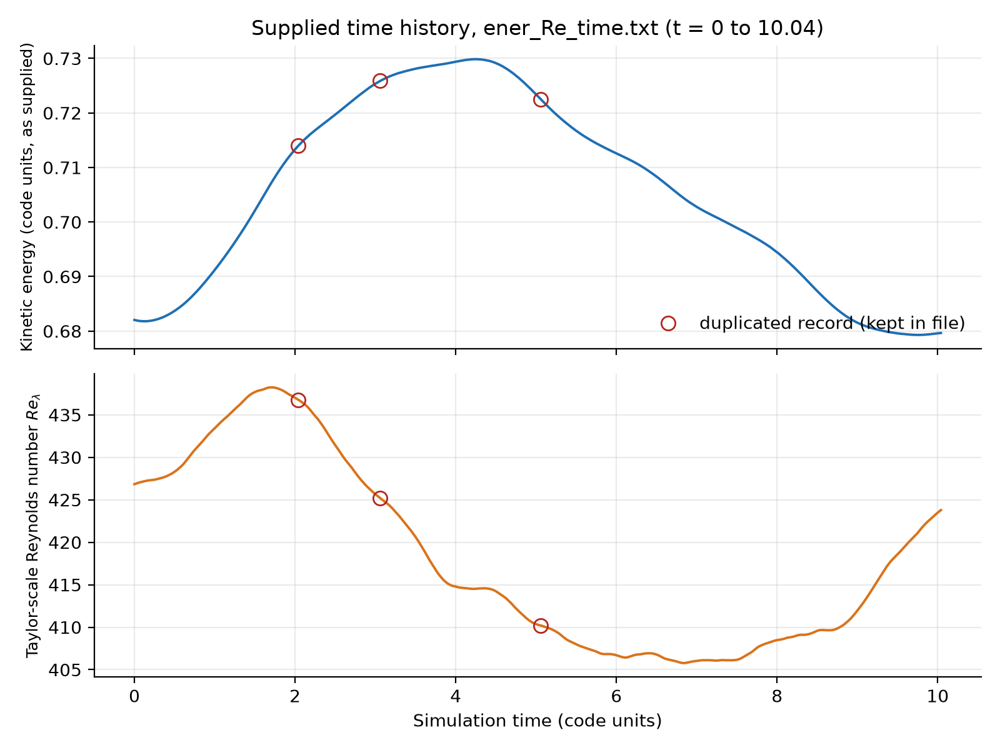
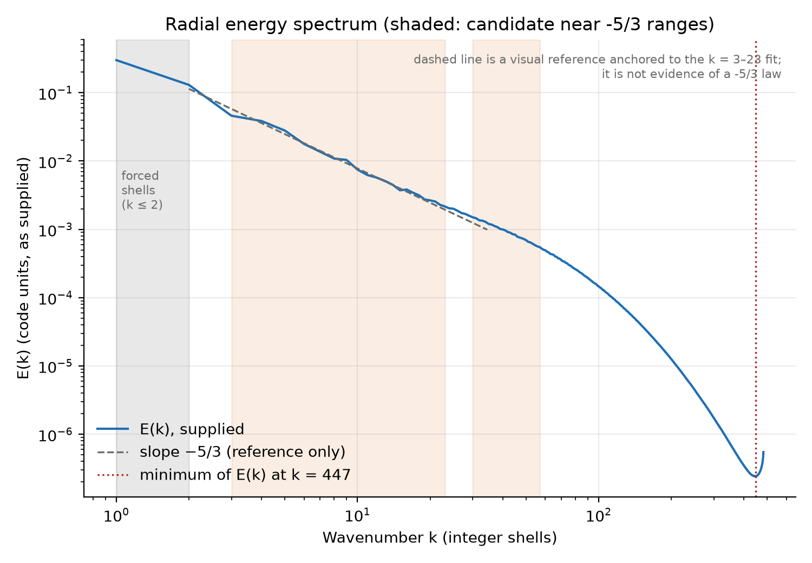
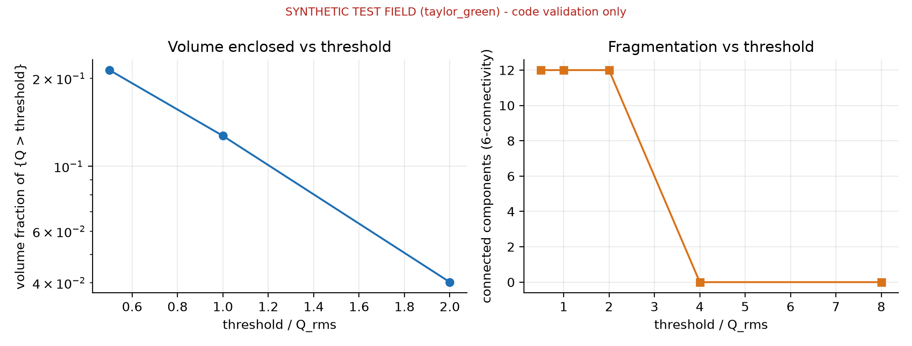
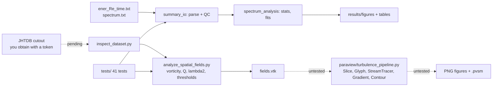

# TurbulenceScope

**Multi-Scale Energy Cascade and Vortex Dynamics in Forced Isotropic Turbulence**
*A reproducible ParaView and Python workflow for scientific visualization, quantitative turbulence analysis, and AI task evaluation.*

Built around the Johns Hopkins Turbulence Database (JHTDB) forced isotropic turbulence dataset (1024³ DNS).

## Status at a glance (read this first)

| Part | Status |
|---|---|
| Analysis of the supplied energy / Re_λ history and radial spectrum | ✅ **Run**, figures and tables in `results/` |
| Vorticity / Q / λ₂ code and threshold-sensitivity tooling | ✅ **Run and tested** on analytic flows (synthetic, not turbulence) |
| Automated tests | ✅ **41 passing** |
| Real 3-D JHTDB cutout analysis (Questions 4–5) | ⏳ **Pending.** Needs your JHTDB token; steps in [`docs/reproducibility.md`](docs/reproducibility.md) |
| ParaView pipeline (`paraview/turbulence_pipeline.py`) | ⚠️ **Written, syntax-checked, not yet executed.** No ParaView figures or `.pvsm` exist yet |
| AI-evaluation tasks | 📝 **Proposed benchmark.** No model has been evaluated |

Nothing in this repository claims a spatial turbulence result. Figures derived from analytic test flows are labelled **SYNTHETIC**.

## Why this is a scientific-visualization project

Choosing a vortex criterion, a threshold, a colour range and a camera are scientific decisions: the picture changes with each, and a
good visualization says so. TurbulenceScope keeps that visible: thresholds are swept rather than fixed, derived fields are
validated against closed-form flows, and each conclusion is tagged with the data that support it (a 1-D spectrum can say how energy is
distributed in scale, but nothing about structures).

## Research questions and where they stand

| # | Question | Evidence | Status |
|---|---|---|---|
| 1 | How does kinetic energy evolve over the record? | `ener_Re_time.txt` | Answered (below) |
| 2 | How does Re_λ vary and what does it tell us? | `ener_Re_time.txt` | Answered, with limits |
| 3 | How is energy distributed over wavenumbers? | `spectrum.txt` | Answered, with limits |
| 4 | Which 3-D rotational structures appear in a real cutout? | needs cutout | **Pending** |
| 5 | How do vortex-identification thresholds change the structures? | needs cutout | Tooling done and validated on synthetic flow; **real result pending** |
| 6 | Can a researcher reproduce all of it? | repo | Tested analysis: yes. ParaView stage: untested |

## Dataset and provenance

JHTDB *Forced Isotropic Turbulence* ("isotropic1024coarse"): pseudo-spectral DNS on a 1024³ periodic grid, domain [0, 2π]³, ν = 0.000185,
velocity and pressure, forcing in |k| ≤ 2. Data are licensed under ODC-By; attribution and the required citations (Li et al. 2008;
Perlman et al. 2007) are in [`data/README.md`](data/README.md). *"Data obtained from the JHTDB at http://turbulence.idies.jhu.edu."*

Included: the two summary files supplied by the project owner (`data/`). Not included: any spatial data. The 1024³ dataset is never downloaded.

## Results from the supplied data

All numbers come from `python scripts/analyze_summaries.py` (`results/tables/summary_results.json`).



**Time history (Q1, Q2).**
* 507 rows, 504 unique records: **three exact duplicates** (t = 2.04, 3.06, 5.06) and an irregular 0.01 step near t = 2.05. Reported, not removed from the file; duplicates are excluded from statistics only. Time runs 0–10.04.
* Energy: 0.6820 at t = 0, rises to a maximum **0.7299 at t = 4.26**, falls to a minimum 0.6793 at t = 9.76, ends at 0.6797. Time-weighted mean 0.7053; peak-to-peak 7.2 % of the mean.
* Re_λ: 426.8 at t = 0, maximum **438.2 at t = 1.70**, minimum **405.8 at t = 6.84**, ends 423.8. Mean **433.0 for t ≤ 2.04** (matches the 433 quoted by JHTDB's README for t = 0–2.048) but **418.0 over the whole record**.
* Energy and Re_λ are essentially uncorrelated over the record (r = −0.05). The files cannot explain why: Re_λ also depends on dissipation, which they do not contain.



**Spectrum (Q3).**
* Strongly large-scale-weighted: E(1) = 0.300, E(2) = 0.130, and E falls by a factor ≈ 2,050 from k = 1 to k = 100.
* **Consistency check:** Σₖ E(k) = 0.7060 versus the time-weighted mean energy 0.7053 (+0.10 %).
* **No −5/3 law is claimed.** Fitted slopes depend on the range: −1.57 (k=3–10), −1.59 (3–23), −1.73 (5–15), −1.44 (10–30), −1.45 (10–50), −1.53 (20–60), −1.60 (30–57), −1.96 (30–100). The compensated spectrum k^{5/3}E varies by a factor of 1.66 over k = 3–60 (maximum near k = 45).
  Fair summary: roughly a power law with exponent about −1.4 to −1.7 over k ≈ 3–60, consistent with but not establishing −5/3. See [`fig_spectrum_compensated.png`](results/figures/fig_spectrum_compensated.png), [`fig_spectrum_local_slope.png`](results/figures/fig_spectrum_local_slope.png) and `results/tables/spectrum_fit_sensitivity.csv`.
* E(k) is minimal at k = 447 and rises for the last shells; the files do not say why; do not interpret k ≳ 300 physically.

## Vortex tooling (validated on synthetic flows only)

`turbulencescope/spatial.py` computes the velocity-gradient tensor (finite-difference for cutouts; spectral cross-check for periodic boxes), vorticity,
Q = ½(‖Ω‖² − ‖S‖²), λ₂, and Q-threshold sensitivity (volume fraction, connected components). Tests check closed-form answers: solid-body rotation (Q = Ω², λ₂ = −Ω²),
pure strain (Q = −a², λ₂ = a²), Taylor–Green vorticity, ABC-flow Beltrami property (ω = u), Galilean invariance, and measured second-order convergence.



*Synthetic Taylor–Green flow, code validation only; not turbulence.* It illustrates the point of the sweep: the volume enclosed by {Q > f·Q_rms} drops about five-fold between f = 0.5 and 2 and is empty above ≈ 3.3·Q_rms.

## Workflow



Dotted edges are not yet exercised on real data / in ParaView.

## Quick start

```bash
python -m venv .venv && source .venv/bin/activate
pip install -r requirements.txt
python -m unittest discover -s tests -v            # 41 tests (or: pytest -q)
python scripts/analyze_summaries.py                # figures + tables for the two supplied files
python scripts/analyze_spatial_fields.py --synthetic taylor_green --n 64 --out-dir results/synthetic_validation
```

Real cutout and ParaView steps: [`docs/reproducibility.md`](docs/reproducibility.md). ParaView 6.x is a separate install (https://www.paraview.org/download/); try the pipeline first on the synthetic file:

```bash
python scripts/run_paraview.py --input results/synthetic_validation/fields.vtk --velocity-array velocity \
    --out-dir results/paraview_synthetic --tag "SYNTHETIC Taylor-Green (pipeline smoke test)"
```

## Repository layout

```
turbulencescope/   summary_io.py, spectrum_analysis.py, spatial.py   (tested library code)
scripts/           inspect_dataset.py, analyze_summaries.py, analyze_spatial_fields.py, run_paraview.py
paraview/          turbulence_pipeline.py   (untested in ParaView)
data/              the two supplied summary files + provenance
results/           figures/, tables/, synthetic_validation/
tests/             test_summary_analysis.py, test_spatial_analysis.py
docs/              literature_review, methodology, reproducibility, scientific_limitations, ai_evaluation_tasks, application_materials
```

## Scientific limitations (short form; full list in [`docs/scientific_limitations.md`](docs/scientific_limitations.md))

The two supplied files are global summaries and cannot reconstruct a velocity field. No −5/3 law, hairpin vortices, or energy-transfer mechanism is claimed. Gradients
from a cutout are approximate (JHTDB quotes ~7 % RMS error for its own); Q isosurfaces depend on threshold, resolution and cutout size; high vorticity is not proof of a vortex.

## AI evaluation tasks

[`docs/ai_evaluation_tasks.md`](docs/ai_evaluation_tasks.md) defines five tasks (identify velocity arrays; design a ParaView workflow; choose a rotational-structure method; debug a
ParaView script; judge whether a spectrum supports a claim), each with prompt, inputs, reference answer, objective scoring and failure modes. **Proposed only; not run against any model.**

## Future improvements

Obtain and analyse a real cutout; run and fix the ParaView pipeline and commit its verified `.pvsm`; multi-time comparisons with fixed colour ranges; band-filtered vorticity/strain (cf. McKeown et al.);
compare ParaView's gradient with the cutout-side NumPy gradient on real data; convergence study with stride.

## References

Li et al. (2008) *J. Turbulence* 9(31); Perlman et al. (2007) SC07; McKeown et al., arXiv:2204.09023; Bürger et al., arXiv:1210.3325. Details and what was and was not read: [`docs/literature_review.md`](docs/literature_review.md).

## License

Code and original documentation: MIT. JHTDB-derived data: ODC-By (attribution required); see `data/README.md`.
